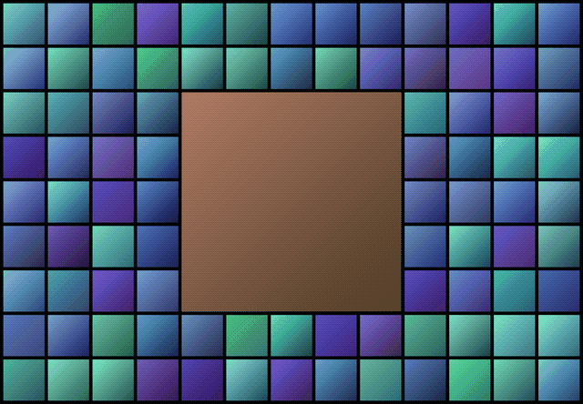
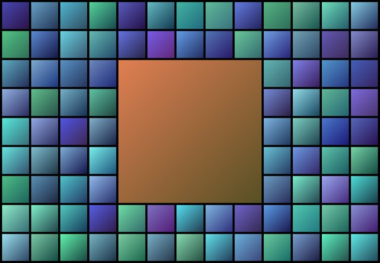
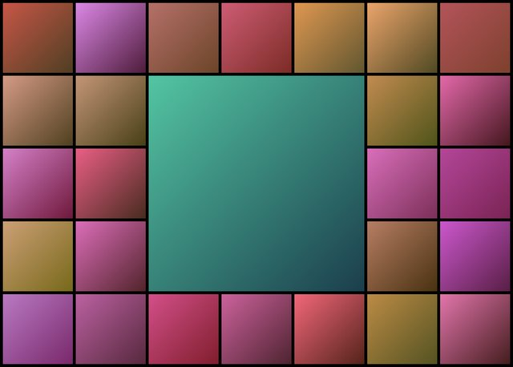
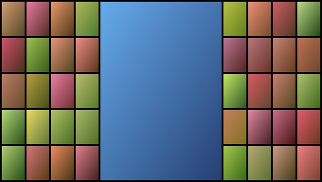
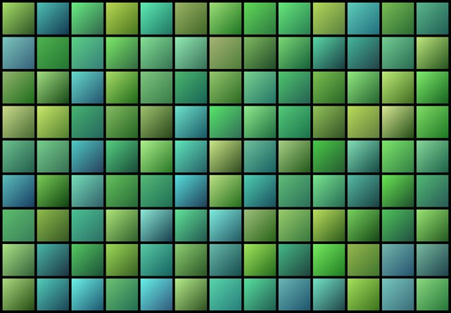

# Anaglypta

> *"Anaglypta is a range of paintable textured wallcoverings made from paper or vinyl."*
>
> — [Wikipedia](https://en.wikipedia.org/wiki/Anaglypta)

Turn a Spotify playlist, a TMDb list of movies and series or a folder of photos into a living wallpaper: a grid of images around a big centrepiece - changing over time. Anaglypta will help you setup your Google Meet background, and change it on a schedule. It's an icebreaker, a conversation piece, or just an excellent way to show off your taste in music, film (or cats).



## Quick start

You need [Node.js](https://nodejs.org) 20+ and [Python](https://www.python.org) 3.12+. For Spotify, first [create a Spotify app](#create-a-spotify-app). For TMDb, first [get a TMDb token](#get-a-tmdb-token). A folder of photos needs nothing else.

```sh
git clone https://github.com/marcelsvensson/anaglypta.git
cd anaglypta
npm ci
npm run setup     # Python, .env and your first project
npm run full      # fetch the images
npm run collage   # draw projects/<source>/<name>/collage.jpg
```

Run `npm run setup` again at any time to add, rename or remove a project, or to pick the default one.

## Sources

Every **source** can have several **projects**, each with its own folder in `projects/<source>/<name>/`.

| Source | A project is | Needs |
|---|---|---|
| `spotify` | a playlist, one tile per album cover | a [Spotify app](#create-a-spotify-app) and Premium |
| `local` | a folder of photos (the folder itself, not its subfolders) | nothing |
| `tmdb` | a public [TMDb](https://www.themoviedb.org) list, one poster per movie or series | a free [TMDb token](#get-a-tmdb-token) |

## Commands

| Command | What it does |
|---|---|
| `npm run setup` | Gets everything ready; adds, renames and removes projects (safe to re-run) |
| `npm run full` | Fetches everything new, up to `maxItems` (`-- --limit n` for at most n) |
| `npm run collage` | Draws a new random collage from what's fetched (no network needed) |
| `npm run video` | *Experimental:* `collage.mp4`, a living collage: 10 minutes where one tile crossfades to another image every 10 s and the centrepiece every minute (`-- --minutes 10 --every 10 --fade 1`; `--rewind` puts the tiles back in the last minute so it loops seamlessly; `--slideshow` for whole collages one after another). `npm run random-meet -- --video` makes one and puts it in your Meet background |
| `npm run daily-new` | Fetches **one** new item, puts it in the middle, sends it to Google Meet: the day-by-day reveal |
| `npm run random-meet` | A new random collage as your Google Meet background |
| `npm run meet` | Sends the current collage to Google Meet (`-- --dry-run` to check first) |
| `npm run setup:meet` | Sets up the Google Meet background, see [below](#google-meet-background) |
| `npm run setup:python` / `npm run auth` | Only the Python part / log in to Spotify again |
| `npm run clean` / `npm run reset` | Remove the image caches / start one project over |
| `npm test` | Run the tests |

Options go after `--`. Every command works on the default project, and `-p` picks another one, as `name` or `source/name`:

```sh
npm run collage -- -p cats           # the project called cats
npm run collage -- --latest          # the newest item in the middle (--cover: a random one, the default; --fill: no centrepiece)
npm run random-meet -- -p mix        # a project from the mix
```

`-p mix` cycles through your projects in a shuffled order, so each comes up once before any comes back. It works with `collage`, `random-meet`, `daily-new` and `meet`. Leave a project out with `"allowMix": false`, or add `-s local` to mix only one source.

## Layouts

A layout is *columns* × *rows* / *centrepiece*, counted in tiles. The centrepiece can be as tall as the grid: `13x5/5` has no row above or below it. `auto` picks the largest widescreen grid your items can fill, with the biggest centrepiece it has, so the grid grows with the project. Tiles are cropped to the project's shape, never stretched.

| | |
|---|---|
|  |  |
| `13x9/5`, the default (93 items) | `auto` with 30 items: `7x5/3` |
|  |  |
| `auto` with 2:3 posters (TMDb's default): `13x5/5` | `--fill`: no centrepiece |

```sh
npm run collage -- --grid              # the layouts that fit the project, and how many items each needs
npm run collage -- --layout 13x7/5     # try one
```

To keep a layout, set it for the project in `projects.json`: `"collage": { "layout": "13x7/5" }`.

## Configuration

`npm run setup` writes your projects to `projects.json` (ignored by git). You can edit it by hand:

```json
{
  "default": "spotify/album",
  "spotify": { "album": { "playlist": "https://open.spotify.com/playlist/..." } },
  "local": { "cats": { "path": "~/Pictures/cats", "aspect": "2:3", "collage": { "layout": "auto" }, "allowMix": false } },
  "tmdb": { "series": { "list": "https://www.themoviedb.org/list/..." } }
}
```

A project can override anything in [`settings.json`](settings.json): `cats` has portrait tiles, a grid that grows with the folder, and stays out of the mix. Project names are lowercase letters, digits and `-`. Every setting and `.env` variable is listed in the [reference](docs/reference.md).

## Google Meet background

*Experimental, macOS and Chrome.*

```sh
npm run setup:meet
```

It walks you through uploading the Anaglypta card (a short video) as a background in Meet once, then finds the file Chrome keeps for it. From then on, `daily-new`, `random-meet` and `meet` put your collage into that background, and `random-meet -- --video` (or `meet -- --video`) puts the moving `collage.mp4` in instead. Reload Meet to see it. In Meet's list the background keeps the card's thumbnail.

Meet's upload button only takes images, so setup gives you one line to paste into Chrome's console first, and puts it in your clipboard. This relies on Chrome internals, so run `setup:meet` again after a Chrome update or a new upload.

## Run it on a schedule

`cron.sh` runs any command from cron and finds Node by itself (asdf, nvm or Homebrew). Try `./cron.sh collage` first, then add a line with `crontab -e`, using the full path:

```cron
# one new album every morning at 8
0 8 * * * /path/to/anaglypta/cron.sh daily-new >> /path/to/anaglypta/daily.log 2>&1
# a new background from the mix every hour, 9–17 on weekdays
0 9-17 * * 1-5 /path/to/anaglypta/cron.sh random-meet -p mix >> /path/to/anaglypta/meet.log 2>&1
```

Options go after the command, without `--`. Nothing in the log? On macOS cron may need Full Disk Access, see the [reference](docs/reference.md#cron-on-macos).

## Create a Spotify app

Anaglypta reads your playlist through your own (free) Spotify developer app. Spotify requires **Premium** for the app's owner, and the playlist must be one you **own or collaborate on**.

1. Go to the [Spotify Developer Dashboard](https://developer.spotify.com/dashboard) and click **Create app**. The name and description can be anything.
2. Under **Redirect URIs**, add exactly `http://127.0.0.1:8888/callback`. Spotify doesn't accept `localhost`; for another port, set `SPOTIFY_AUTH_PORT` in `.env`.
3. Accept the terms, **Save**, and copy the **Client ID** from **Settings**.
4. Copy your playlist's link in Spotify (**⋯ → Share → Copy link to playlist**).

`npm run setup` asks for both and opens your browser once to log in (stored in `.spotify-token.json`, keep it private). New apps allow up to 5 users, and others must be added under **User Management**. Apps from before 2026 can use `CLIENT_SECRET` in `.env` instead of the login.

## Get a TMDb token

1. Make an account at [themoviedb.org](https://www.themoviedb.org/signup).
2. In [Settings → API](https://www.themoviedb.org/settings/api), request a key for personal use. As the application URL, `http://127.0.0.1` is fine.
3. Copy the **API Read Access Token** (the long one starting with `eyJ`), not the API Key.

`npm run setup` asks for it and for your list's link. The list must be **public**.

## Troubleshooting

| Problem | Fix |
|---|---|
| `Not logged in to Spotify` / `invalid_grant` | `npm run auth` |
| `403` from Spotify | The playlist must be yours (or shared with you), and the app owner needs Premium |
| `npm error Unknown cli flag` | Put `--` before the options: `npm run collage -- --latest` |
| `Nothing fetched for ... yet` | `npm run full` first, with the same `-p` |

More in the [reference](docs/reference.md#troubleshooting).

## TMDb

This product uses the TMDB API but is not endorsed or certified by TMDB.

<a href="https://www.themoviedb.org"></a>

Posters and titles come from TMDb and belong to their rights holders. The generated images are for your own use: don't commit or redistribute them, and follow the [TMDb API terms](https://www.themoviedb.org/api-terms-of-use). TMDb allows caching for at most 6 months, and Anaglypta keeps to that by itself ([how](docs/reference.md#tmdbs-6-month-limit)).

## Spotify content

Album covers and names come from Spotify and belong to Spotify and the rights holders. The generated images are for your own use: don't commit or redistribute them, and follow the [Spotify Developer Terms](https://developer.spotify.com/terms).

## License

[ISC](LICENSE)
